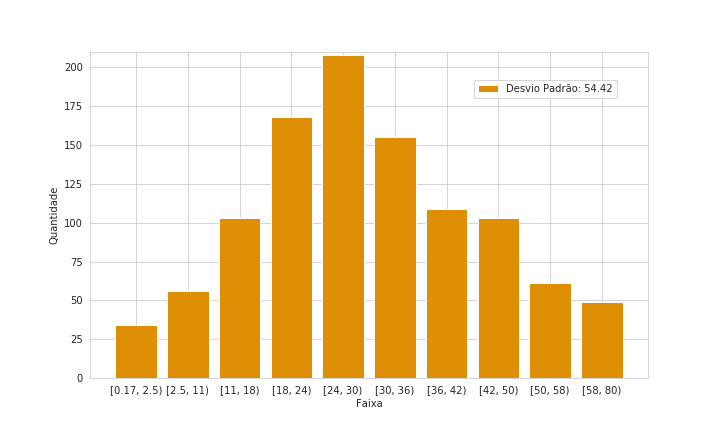

# Tabular ML Toolkit: bibliotecas de análise de dados e machine learning para dados tabulares

Bibliotecas em Python que comecei em 2020 e desenvolvi principalmente em 2021, durante o curso de extensão em **Mineração de Dados Complexos** do Instituto de Computação da Unicamp, para apoiar meus estudos e projetos de ciência de dados. Elas cobrem o ciclo de um modelo em dados tabulares:
- análise exploratória;
- discretização e tratamento de variáveis;
- modelos próprios;
- avaliação detalhada, inclusive por segmento;
- explicabilidade.

Os cálculos mais pesados são compilados com [numba](https://numba.pydata.org/).

> **English summary.** Python libraries I wrote in 2020–2022 for machine learning on tabular data. They include supervised discretization (information gain or R²), compiled with numba; dataset and model diagnostics with segment-level metrics (AUC, KS, lift, information gain); custom series-expansion learners trained by sign-consistent gradient descent across several data splits; and perturbation-based local explanations. The repository also has worked examples, Kaggle applications, a 2025 study on training techniques, a custom neural-network optimizer that only accepts steps improving every training subset (2024–2025), and a short neuroevolution test with PyGAD (2023). Code and docs are in Portuguese.

<p align="center"></p>

## Destaques

1. **Discretização supervisionada.**
   - `CortaIntervalosGanhoInformacao` escolhe as faixas de uma variável que maximizam o ganho de informação sobre um alvo binário.
   - `CortaIntervalosR2` faz o mesmo para um alvo contínuo, maximizando o R².
   - O algoritmo parte de faixas com o mesmo número de valores distintos e desloca as fronteiras enquanto o critério melhora.
   - Ele nunca separa valores repetidos e respeita um mínimo de observações por faixa.
   - As animações em [`exemplos/imagens/`](exemplos/imagens/) mostram a busca passo a passo.
2. **Avaliação completa de um modelo em uma linha.**
   - `AvaliaDatasetsClassificacao` compara treino e teste em LogLoss, AUC, KS, captura e alavancagem nos 10% e 20% de maior e de menor probabilidade, e ganho de informação do score.
   - Também calcula o ponto de corte ótimo e uma "zona de incerteza" entre dois cortes (`IG_2D`).
   - As mesmas métricas saem por faixa de qualquer variável, o que mostra onde o modelo funciona bem ou mal.
   - Há classes equivalentes para regressão e para modelos que preveem uma distribuição.
3. **Um modelo próprio: `SeriesMultiGradient`.**
   - É uma regressão linear ou logística sobre uma expansão em série de Taylor e de Laurent das variáveis: potências, inversas e interações.
   - Ela é treinada por descida do gradiente em vários conjuntos ao mesmo tempo, como as divisões de uma validação cruzada.
   - Um parâmetro só se move quando o gradiente aponta na mesma direção em todos os conjuntos.
   - O modelo final é a média dos melhores parâmetros de cada conjunto, e as curvas de viés e variância saem do próprio treino.
   - A ideia lembra a AND-mask de [Parascandolo et al. (2021)](https://arxiv.org/abs/2009.00329), que também zera os componentes do gradiente com sinais divergentes entre ambientes.
4. **Explicabilidade.**
   - Importância das variáveis por permutação, com incerteza.
   - Um mapa de calor por exemplo, que mostra quanto cada valor empurra a previsão para cima ou para baixo quando é trocado por valores sorteados da base. É a mesma ideia de perturbação do [projeto Retinal OCT](https://github.com/alexandrebcruz/retinal-oct-classification), aplicada a dados tabulares.
5. **Reprodutível em 2026.**
   - Os quatro notebooks de [`exemplos/`](exemplos/) rodaram de novo de ponta a ponta, em Python 3.11, com as versões de [`requirements.txt`](requirements.txt).
   - As métricas do classificador e do regressor bateram com as de 2021 até a sexta casa decimal.
   - Só mudaram as saídas que dependem de sorteio (importância por permutação, mapa de calor, amostragem do Kendall tau) e as do CatBoost, que hoje está em outra versão.

## Módulos

| Módulo | Para quê | Classes principais |
|---|---|---|
| `AleTransforms` | Discretização e tratamento de variáveis | `CortaIntervalosQuasiUniforme`, `CortaIntervalosGanhoInformacao`, `CortaIntervalosR2`, `FiltraCategoriasRelevantes`, `TrataDataset`, `TaylorLaurentSeries` |
| `AleDatasetAnalysis` | Análise exploratória e comparação de distribuições entre bases | `DistribuicoesDataset`, `AvaliaDatasetsDistribuicoes` |
| `AleMetrics` | Métricas de classificação, regressão e distribuição de probabilidade | `AletricasClassificacao`, `AletricasRegressao`, `AletricasDistribuicaoProbabilidade` |
| `AleMLAnalysis` | Avaliação de modelos por base e por segmento, com gráficos | `AvaliaClassificacao`, `AvaliaRegressao`, `AvaliaDistribuicaoProbabilidade` e as versões `AvaliaDatasets*`, que comparam várias bases |
| `AleLearners` | Modelos próprios por expansão em série | `SeriesMultiGradientClassifier`, `SeriesMultiGradientRegressor`, `DiscretizaAlvoRegressivo` |
| `AleExplainers` | Explicabilidade | `ImportanciaVariaveisClassificacao`, `ImportanciaVariaveisRegressao`, `CamClassificacao`, `CamRegressao` |
| `AleCFunctions`, `AleCFunctionsLearners` | Funções numéricas compiladas com numba, usadas pelos outros módulos | — |

A referência de cada classe, com parâmetros, métodos e métricas, está em [`docs/modulos.md`](docs/modulos.md).

## Instalação

O código é de 2021–2022 e depende de versões daquela época: com numpy ≥ 1.24, scikit-learn ≥ 1.4 ou pandas 3, partes dele quebram. Use Python 3.8 a 3.11 num ambiente virtual próprio:

```bash
git clone https://github.com/alexandrebcruz/tabular-ml-toolkit.git
cd tabular-ml-toolkit
python3.11 -m venv .venv && source .venv/bin/activate
pip install -r requirements.txt   # versões testadas em 2026
pip install -e .                  # instala os módulos Ale* a partir de src/
```

Os módulos são importados pelo nome, como nos notebooks originais:

```python
import pandas as pd
import AleTransforms as trf
import AleMLAnalysis as aml

df = pd.read_csv("train.csv")              # Titanic, do Kaggle
df = df[df["Age"].notna()]

# Faixas de idade que maximizam o ganho de informação sobre a sobrevivência
corte = trf.CortaIntervalosGanhoInformacao(df["Age"].values, df["Survived"].values, num_div=5, qtd_min=50)
corte.info_discretizacao()                 # quantidade, quantidade do alvo e limites de cada faixa

# Avaliação de um score em duas bases, no geral e por faixa de idade
df["Prob"] = 0.1 + 0.6 * (df["Sex"] == "female") + 0.2 * (df["Pclass"] == 1)
bases = {"Treino": df.iloc[: len(df) // 2], "Teste": df.iloc[len(df) // 2 :]}
aval = aml.AvaliaDatasetsClassificacao(bases, "Survived", "Prob")
aval.valor_metricas()                      # LogLoss, AUC, KS, lift, ganho de informação, cortes...
aval.calcula_metricas_condicionais(bases, "Age")
aval.grafico_metricas_condicionais("Age", metricas=["AUC", "KS"])
```

## Estrutura

```text
src/          os 8 módulos Ale*
docs/         referência das classes (modulos.md)
exemplos/     4 notebooks que mostram as bibliotecas, com as animações do algoritmo
aplicacoes/   uso em competições do Kaggle e em redes neurais (2021-2022)
estudos/      técnicas de treinamento (2025), treino personalizado de redes neurais (2024-2025),
              exportação para PMML e ONNX (2022) e neuroevolução com PyGAD (2023)
```

| Pasta | Conteúdo |
|---|---|
| [`exemplos/`](exemplos/) | **Titanic:** visão geral de todos os módulos. **Ilustração dos algoritmos de discretização:** gera as animações. **House Prices:** estimativa da distribuição do preço com um classificador por faixa. **Churn bancário:** CatBoost e o modelo próprio, avaliados com as bibliotecas, inclusive numa divisão por sobrenome. |
| [`aplicacoes/`](aplicacoes/) | **[Porto Seguro Data Challenge](https://www.kaggle.com/c/porto-seguro-data-challenge) (2021):** baseline, seleção de variáveis, validação cruzada e aumentação de dados. **[Ubiquant Market Prediction](https://www.kaggle.com/c/ubiquant-market-prediction) (2022):** baseline e rede neural. **Redes neurais (2021):** um autoencoder para detectar fraude em cartão de crédito e uma rede recorrente para reconhecer atividades. |
| [`estudos/`](estudos/) | [Técnicas de treinamento (2025)](estudos/tecnicas_de_treinamento_2025/): grid search contra curva de viés e variância, modelo único contra modelos por segmento, e o efeito do tamanho da amostra, na base pública Telco Customer Churn. [Treinamento personalizado de redes neurais (2024–2025)](estudos/treinamento_personalizado_2025/): um otimizador em que cada passo precisa melhorar todos os subconjuntos do treino, com a direção escolhida por otimização convexa. No Titanic, teve 84,3% de acurácia no teste, contra 82,7% de um CatBoost. [Exportação de modelos para PMML e ONNX (2022)](estudos/exportacao_pmml_onnx_2022/). [Neuroevolução com PyGAD (2023)](estudos/neuroevolucao_pygad_2023/). |

Cada pasta tem um README com o que cada notebook faz e de onde vêm os dados.

## Histórico

- **2020.** As primeiras funções nasceram nos estudos com a base do Titanic: análise de datasets, discretização por entropia (MDLP) e avaliação de modelos.
- **1º semestre de 2021.** Tudo virou uma biblioteca única, a "Aleoteca". Depois ela foi dividida nos módulos `Ale*`, durante o curso de Mineração de Dados Complexos. Uma versão de junho de 2021 foi usada num experimento do projeto final do curso, o [retinal-oct-classification](https://github.com/alexandrebcruz/retinal-oct-classification).
- **2º semestre de 2021.** Entraram as funções compiladas com numba, a explicabilidade e a competição Porto Seguro. Em setembro, o código foi para o GitHub.
- **Dezembro de 2021 a fevereiro de 2022.** Últimas correções, nas métricas de classificação e no LogLoss, e a competição Ubiquant.
- **2023 a 2025.** Vieram os estudos:
  - a neuroevolução com PyGAD, em 2023;
  - o treinamento personalizado de redes neurais, de 2024 a 2025, que leva às redes a ideia do `SeriesMultiGradient`;
  - as técnicas de treinamento, em 2025, que usam `AleFuncoes.py`, uma versão enxuta das funções de discretização, sem numba.

## Sobre esta versão

Este repositório reúne, em 2026, o que estava num repositório privado mais antigo e no meu Google Drive.

- **Código das bibliotecas.**
  - É a versão mais recente, de fevereiro de 2022. Ela estava no Drive e tinha duas correções que nunca tinham ido para o GitHub.
  - Teve uma única alteração: em `AleCFunctions.py`, as funções `unicos_qtds_alvos` e `unicos_qtds_alvos2` passaram a acumular o alvo como número decimal. Sem isso, o numba a partir da versão 0.50 recusa alvos decimais, como os da discretização por R².
  - As saídas dos exemplos continuam as mesmas de 2021.
- **Notebooks.**
  - Saíram os metadados do Colab, os links para pastas privadas, os caminhos pessoais e os nomes do projeto e do bucket do Google Cloud.
  - Os logs de treino muito longos foram encurtados, e os tracebacks de interrupções manuais viraram uma nota.
  - Nada mais mudou: código, gráficos e resultados são os originais.
  - Os nomes dos notebooks de `exemplos/`, de `aplicacoes/` e dos estudos de 2023 e de 2024–2025 foram padronizados. A correspondência com os nomes originais está no README de cada pasta.
- **Ficaram de fora:**
  - os datasets, que devem ser baixados das fontes;
  - os modelos treinados;
  - os projetos de trading que também usam as bibliotecas;
  - as versões antigas das bibliotecas, de 2020 e do 1º semestre de 2021.

Comportamentos do código que vale conhecer estão em [`docs/modulos.md`](docs/modulos.md#comportamentos-a-conhecer).

O repositório não tem licença de uso: os direitos são do autor, e a leitura é livre. Cada dataset tem a licença da sua fonte.

## Autor

Alexandre Béo da Cruz · [LinkedIn](https://www.linkedin.com/in/alexandrebeocruz/) · [Lattes](http://lattes.cnpq.br/2043689348770159) · [ORCID](https://orcid.org/0000-0002-3192-3209)
